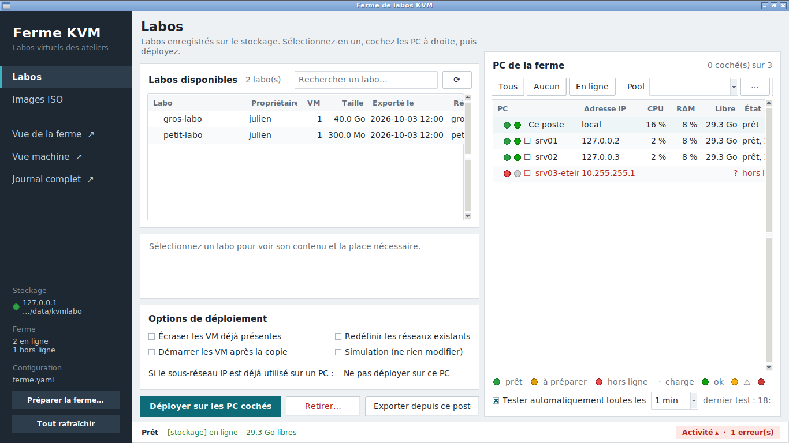
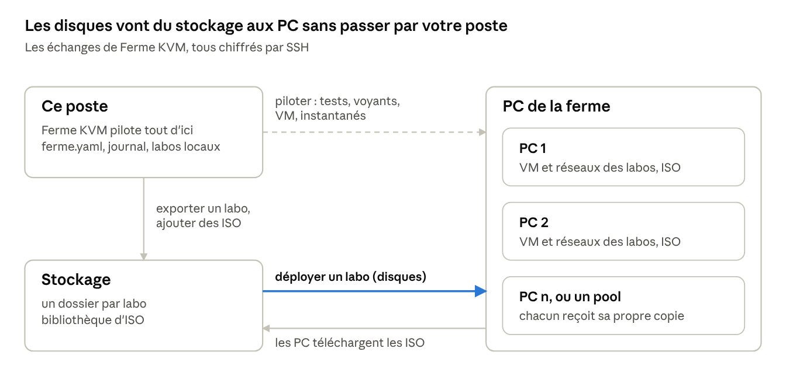
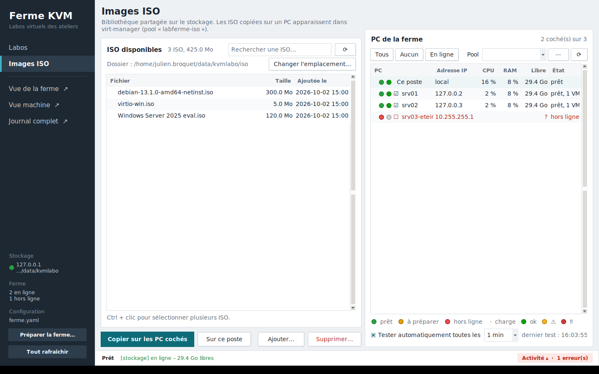
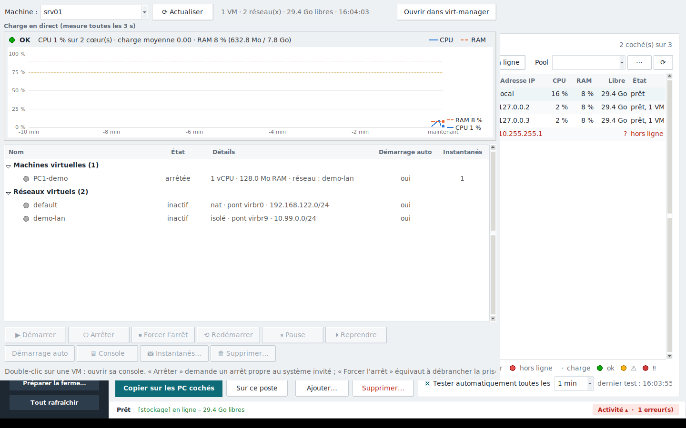

# Ferme KVM

Ferme KVM sauvegarde les labos virtuels (réseaux + VM) d'un poste sur un serveur de stockage, puis les déploie sur les PC d'une ferme Debian/KVM : sur toute la ferme, sur un pool ou sur quelques PC choisis. Conçu pour les ateliers des apprentis CFC, où plusieurs enseignants partagent la même ferme avec chacun leurs labos. Sans serveur de stockage, un labo peut aussi être transféré directement d'une machine à une ou plusieurs autres ([voir plus bas](#transférer-un-labo-sans-stockage-secours)).

**Version 1.2.0** (2026-10-29) · Python 3 · Tkinter · libvirt · SSH + rsync



## Comment ça marche



Le poste pilote tout, le stockage garde les labos et les ISO, et chaque PC reçoit ses disques directement du stockage : déployer sur 20 PC ne charge pas votre poste. Un labo peut être exporté depuis ce poste, depuis un PC de la ferme ou depuis une autre machine (une « source ») : il n'est pas nécessaire que le labo soit installé sur la machine qui exécute Ferme KVM.

Un **labo** = un ou plusieurs réseaux virtuels libvirt + toutes les VM qui y sont branchées. Sur le stockage, chaque labo est un dossier :

```
<chemin>/<labo>/labo.json          manifeste (propriétaire, réseaux, VM, disques)
<chemin>/<labo>/xml/               définitions des réseaux et des VM
<chemin>/<labo>/disques/           disques (qcow2/raw) et NVRAM UEFI
```

## Installation

Le programme tourne sur le poste de l'enseignant ; rien n'est installé à la main sur les PC de la ferme.

| Machine | Prérequis |
| --- | --- |
| Poste | Debian ou Ubuntu, Python 3.9+, `python3-tk python3-paramiko python3-yaml rsync` ; `virt-viewer` pour ouvrir l'écran des VM |
| PC de la ferme | Debian avec KVM, libvirt, serveur SSH actif, IP fixe, un compte (sudoer ou non) |
| Stockage | Linux (Debian, NAS Synology…) avec SSH, rsync et un compte qui possède le dossier des labos |

```bash
sudo apt install python3-tk python3-paramiko python3-yaml rsync virt-viewer
git clone <ce dépôt> ferme-kvm && cd ferme-kvm
cp ferme.exemple.yaml ferme.yaml      # puis adapter (voir Configuration)
chmod 600 ferme.yaml                  # contient des mots de passe
python3 labferme_gui.py               # ou : python3 labferme_gui.py -c autre.yaml
```

Sans `ferme.yaml`, l'interface propose de le créer : il suffit d'indiquer le stockage, puis d'ajouter les PC avec « + Ajouter un PC… ».

`ferme.yaml` est exclu du dépôt par `.gitignore` : ne le publiez jamais.

## Configuration

Toute la ferme est décrite dans `ferme.yaml` : le stockage, les valeurs communes, puis un bloc par PC. La section `stockage` est facultative si vous n'utilisez que le transfert direct. Les mots de passe ne servent qu'à la préparation ; ensuite tout passe par clés SSH.

```yaml
stockage:
  ip: 192.168.100.10
  utilisateur: enseignant
  mot_de_passe: "..."
  chemin: /volume1/homes/enseignant/Data/kvmlabo
  chemin_iso: /volume1/homes/enseignant/Data/kvmlabo/iso

defaut:
  utilisateur: administrateur
  mot_de_passe: "..."
  images: /var/lib/libvirt/images/labos
  isos: /var/lib/libvirt/images/iso

hotes:
  - nom: KVM-01
    ip: 192.168.100.11
    pools: [atelier-reseau, salle-a]

sources:                     # facultatif : machines d'où l'on exporte, jamais des cibles
  - nom: poste-collegue
    ip: 192.168.100.50
    utilisateur: collegue
```

| Clé | Rôle |
| --- | --- |
| `stockage.chemin` | Dossier des labos sauvegardés (un sous-dossier par labo) |
| `stockage.chemin_iso` | Dossier des ISO ; modifiable depuis l'interface |
| `defaut.*` | Valeurs prises par tous les PC, surchargeables PC par PC |
| `images` | Où les disques des labos sont copiés sur chaque PC |
| `isos` | Où les ISO sont copiées sur chaque PC |
| `pools` | Groupes de PC ; se gèrent aussi depuis l'interface |
| `hotes` | PC de la ferme (cibles des déploiements) ; ajout, modification et retrait depuis l'interface |
| `sources` | Machines d'export (poste d'un collègue, PC de préparation…) ; jamais des cibles de déploiement depuis le stockage, mais elles peuvent envoyer ou recevoir un transfert direct |
| `mot_de_passe_root` | Facultatif, pour un compte non sudoer ; sinon l'interface le demande |

L'interface réécrit `ferme.yaml` quand on modifie le stockage, un PC, une source, un pool ou l'emplacement des ISO : les commentaires ajoutés à la main disparaissent alors. Le fichier garde ses droits (600 s'il est créé par l'interface).

## Première mise en route

Trois préparations, une seule fois, puis à chaque nouvelle machine. Aucune ne touche aux VM existantes.

1. **Stockage (NAS Synology)** : dans DSM, activer le service SSH (Terminal et SNMP), le service d'accueil de l'utilisateur, le service rsync (Services de fichiers → rsync) et autoriser l'application rsync pour le compte (Utilisateur et groupe → Applications). Un stockage Debian n'a besoin que de `openssh-server` et `rsync`.
2. **PC de la ferme** : barre latérale → « Préparer la ferme… » (ou clic droit sur un PC → « Préparer ce PC… »). Le programme échange les clés SSH, donne au compte une règle sudo limitée et le met dans les groupes libvirt et kvm. Si le compte n'est pas sudoer, il demande le mot de passe root du PC (utilisé par `su`, jamais enregistré).
3. **Ce poste** : clic droit sur la ligne « Ce poste » → « Préparer ce poste… ». Nécessaire pour exporter un labo et recevoir des ISO.

Vérification : tous les voyants passent au vert, et un clic sur le stockage (barre latérale) → « Tester l'accès depuis ce poste (SSH + rsync) » doit afficher quatre ✔.

Nouvelle machine : « + Ajouter un PC… » en haut de la liste des PC, en laissant cochée « Préparer cette machine après l'enregistrement ».

## L'interface

| Zone | Contenu |
| --- | --- |
| Barre latérale (gauche) | Pages Labos et Images ISO ; fenêtres Transférer un labo, Vue de la ferme, Vue machine, Journal complet (↗) ; stockage (clic : configurer, état, test), résumé de la ferme, fichier de configuration, « Préparer la ferme… », « Tout rafraîchir » |
| Page (centre) | La liste du stockage (labos ou ISO) avec recherche, le détail de l'élément choisi, les options et les boutons d'action |
| PC de la ferme (droite) | « + Ajouter un PC… » ; une ligne par PC : deux voyants, case à cocher, IP, CPU, RAM, place libre, état ; Tous / Aucun / En ligne, choix d'un pool, test immédiat |
| Barre d'état (bas) | Opération en cours, dernier message, bouton « Activité » qui ouvre le journal récent et compte les erreurs |

- Clic sur un PC : le cocher. Double-clic : Vue machine. Clic droit : détails, test d'accès au stockage, préparation, modifier, retirer de la ferme.
- Le bouton principal de chaque page est en bleu pétrole ; les actions qui suppriment sont en rouge.
- Survoler un bouton ou une option affiche ce qu'il fait.
- Raccourcis : F5 tout rafraîchir, Ctrl+1 Labos, Ctrl+2 ISO, Ctrl+F rechercher, Ctrl+J activité.

## Tâches courantes

### Configurer le stockage

Barre latérale → clic sur « Stockage » → « Configurer le stockage… » : serveur, compte, mot de passe, dossier des labos et dossier des ISO (par défaut le sous-dossier `iso`).

- « Tester » vérifie, sans rien modifier, le port SSH, la connexion, rsync et les dossiers (place libre, nombre de labos).
- « Enregistrer » refait le test, crée les dossiers absents puis écrit `ferme.yaml`. Si le test échoue, l'interface demande confirmation.
- Nouveau serveur (IP ou compte changé) : l'interface propose « Préparer la ferme » pour y installer les clés de ce poste et des PC. Les machines sources sont à repréparer depuis la fenêtre d'export.
- Les labos déjà présents dans l'ancien dossier ne sont pas déplacés.

### Ajouter, modifier ou retirer un PC

- **Ajouter** : « + Ajouter un PC… » en haut de la liste des PC. Nom, IP, compte (vide = celui de `defaut`), mot de passe (vide = celui de `defaut`), pools, dossier des disques. « Tester la connexion » affiche le même voyant que la liste. Avec « Préparer cette machine après l'enregistrement », les clés et les droits sont installés tout de suite.
- **Modifier** : clic droit sur le PC → « Modifier ce PC… ». Un mot de passe laissé vide n'est pas changé.
- **Retirer** : clic droit → « Retirer de la ferme… ». Le PC sort de `ferme.yaml` ; ses VM, disques et réseaux restent en place. Deux options :
  - « Révoquer sa clé SSH sur le stockage » (cochée) : le PC ne peut plus lire ni écrire sur le stockage ;
  - « Nettoyer aussi la machine » : supprime la règle sudo, `~/.ssh/labferme` et les clés `labferme-…` du PC. Plus aucun poste, y compris ceux des collègues, ne peut alors le piloter.

### Exporter un labo

Le labo peut se trouver sur ce poste, sur un PC de la ferme ou sur une autre machine : les disques partent directement de cette machine vers le stockage.

1. Page Labos → « Exporter un labo… ».
2. « Machine source » : ce poste, une source enregistrée ou un PC de la ferme. « + Autre machine… » ajoute une source (nom, IP, compte, mot de passe) ; « ⋯ » la modifie ou la retire.
3. Si la machine n'est pas prête (clé SSH, règle sudo), un voyant orange l'explique : « Préparer cette machine… » installe la clé de ce poste sur elle, sa clé sur le stockage et la règle sudo. Le mot de passe root est demandé si le compte n'est pas sudoer.
4. Cocher le ou les réseaux virtuels du labo : toutes les VM branchées dessus sont incluses.
5. Donner un nom (lettres, chiffres, `.` `_` `-`), un propriétaire et une description.
6. Laisser coché « Éteindre proprement les VM allumées » : elles sont relancées après la copie.

Une source n'est jamais une cible de déploiement depuis le stockage et n'apparaît pas dans la liste des PC (elle peut en revanche recevoir un [transfert direct](#transférer-un-labo-sans-stockage-secours)). Contrairement à un PC de la ferme, elle ne reçoit pas la clé du stockage : elle peut écrire sur le stockage, mais le stockage ne peut pas se connecter à elle.

Un disque issu d'un instantané est fusionné en un fichier complet (« aplatissement ») ; il faut assez de place dans `/var/tmp` de la machine source. La liste des instantanés n'est pas exportée.

### Déployer un labo

1. Page Labos : sélectionner le labo. Le détail indique la place nécessaire par PC.
2. À droite : cocher les PC, ou choisir un pool. Un ⚠ dans « Libre » signale un PC trop plein.
3. Options si besoin : écraser les VM existantes, redéfinir les réseaux, démarrer les VM, simulation, et la conduite à tenir si le sous-réseau est déjà pris.
4. « Déployer sur les PC cochés ».

Les disques partent du stockage directement vers chaque PC (4 en parallèle). Si le pont `virbrN` est pris, le suivant libre est utilisé ; les VM sont rebranchées par nom de réseau. Les PC sans assez de place (+ 2 Go de marge) sont exclus.

### Transférer un labo sans stockage (secours)

Quand il n'y a pas de stockage central (panne du NAS, atelier isolé, essai rapide), un labo peut être déployé **directement d'une machine vers d'autres** : la machine de départ lit le labo (réseaux + VM) et envoie les disques à chaque destination. Rien n'est écrit sur un stockage, et `ferme.yaml` n'a pas besoin de section `stockage`.

La machine de départ et les destinations peuvent être **ce poste, un PC de la ferme ou une machine « source »** (n'importe laquelle vers n'importe laquelle, sauf elle-même).

1. Barre latérale → « Transférer un labo ↗ ».
2. « Machine de départ » : choisissez où se trouve le labo (« + Autre machine… » ajoute une source) et cochez le ou les réseaux virtuels : toutes les VM branchées dessus sont incluses.
3. Cochez les destinations (« Tous les PC » coche les PC de la ferme). Un voyant par destination indique si la liaison depuis la machine de départ fonctionne : vert = prête, orange = à préparer, rouge = injoignable.
4. Si une liaison est orange : « Préparer les liaisons… » installe la clé SSH de la machine de départ sur chaque destination, la clé de ce poste sur les machines qu'il pilote, et les droits (règle sudo, groupes libvirt/kvm). À faire une fois par couple départ → destination.
5. Nom du labo, options (écraser les VM présentes, redéfinir les réseaux, démarrer les VM, simulation, sous-réseau déjà pris : mêmes effets que pour un déploiement depuis le stockage), puis « Transférer ».

En ligne de commande :

```bash
python3 labferme.py lier --depuis KVM-01 --vers KVM-02 --vers KVM-03          # une fois
python3 labferme.py transferer -r reseau-labo --depuis KVM-01 --vers KVM-02 --vers KVM-03 --arreter
python3 labferme.py transferer -r reseau-labo --depuis poste-collegue --tous --simulation
python3 labferme.py transferer -r reseau-labo --depuis KVM-01 --vers local     # vers ce poste
```

À savoir :

- Les VM allumées de la machine de départ sont éteintes proprement pendant la copie (option cochée par défaut), puis relancées, même si la copie échoue.
- Les disques sont envoyés **de la machine de départ vers chaque destination** (ou, si la destination est ce poste, récupérés par ce poste) : ils ne passent pas par ce poste dans les autres cas. Plusieurs destinations se partagent le réseau de la machine de départ ; 2 sont servies en même temps (`--parallele N`).
- Un disque issu d'un instantané est fusionné **une seule fois** en un fichier complet, même avec plusieurs destinations : il faut assez de place dans `/var/tmp` de la machine de départ (vérifié avant de toucher aux VM). La place libre de chaque destination est vérifiée comme pour un déploiement.
- Avant d'éteindre quoi que ce soit, le programme vérifie les droits, la clé SSH et rsync de chaque liaison ; si l'une est incomplète, rien n'est modifié.
- Les commandes `transferer`, `lier` et `pc-ajouter` fonctionnent sans stockage ; sans stockage, la page Labos est vide et les ISO sont indisponibles.

### Retirer un labo

Sélectionner le labo, cocher les PC, « Retirer… » : VM, disques et réseaux du labo sont supprimés ; un réseau encore utilisé par une autre VM est conservé.

### Images ISO



- « Ajouter… » envoie des `.iso` de ce poste vers le stockage (reprise possible si coupé).
- Sélectionner une ou plusieurs ISO (Ctrl + clic), puis « Copier sur les PC cochés » ou « Sur ce poste ».
- Sur chaque PC, les ISO arrivent dans `/var/lib/libvirt/images/iso` et apparaissent dans virt-manager, pool « labferme-iso ».
- « Changer l'emplacement… » modifie le dossier des ISO sur le stockage.

### Vue de la ferme

Un tableau labos × PC : ✔ complet, ◐ partiel (VM ou réseau manquant), ▶n VM en marche, ✖ PC injoignable. La ligne grise compte les VM et réseaux qui ne viennent d'aucun labo du stockage. Le bouton du bas sélectionne le labo et coche les PC où il est déployé.

### Vue machine et instantanés



Double-clic sur un PC. On y voit la charge CPU et RAM en direct (10 dernières minutes), les VM et les réseaux, et on peut :

- démarrer, arrêter proprement, forcer l'arrêt, redémarrer, mettre en pause, régler le démarrage automatique ;
- ouvrir l'écran d'une VM (🖥 Console ou double-clic), ou tout le PC dans virt-manager ;
- créer, restaurer ou supprimer un instantané (★ = instantané courant) ;
- supprimer une VM avec ses disques.

## Voyants et surveillance

Chaque PC porte deux voyants, testés au démarrage puis toutes les minutes (réglable de 30 s à 5 min, ou désactivable).

| Voyant | Couleur | Signification | Que faire |
| --- | --- | --- | --- |
| 1er : connexion | Vert | Prêt : SSH et droits libvirt complets | Rien |
| 1er : connexion | Orange | Le PC répond mais doit être préparé (droits, clé, mot de passe SSH) | Clic droit → « Préparer ce PC… » |
| 1er : connexion | Rouge | Port SSH 22 injoignable : éteint, débranché ou SSH arrêté | Allumer, vérifier le câble et `systemctl status ssh` |
| 1er : connexion | Gris | Test en cours | Attendre |
| 2e : charge | Vert | CPU et RAM sous 75 % | Rien |
| 2e : charge | Orange ⚠ | Le plus chargé des deux entre 75 et 90 % | Surveiller, éviter d'y déployer |
| 2e : charge | Rouge ‼ | 90 % ou plus | Arrêter des VM ou choisir un autre PC |

Le voyant du stockage (barre latérale) suit la même logique. Les seuils de charge se changent en tête de `labferme.py` (`SEUIL_ATTENTION`, `SEUIL_CRITIQUE`).

## Dépannage

Le détail de chaque erreur est dans le journal : « Journal complet », filtre « Erreurs seulement », ou le fichier `~/.local/state/labferme/labferme.log` (aucun mot de passe n'y est écrit).

| Message ou symptôme | Cause | Solution |
| --- | --- | --- |
| « échec de sudo -n virsh », voyant orange « droits insuffisants » | Le compte n'est ni sudoer ni dans le groupe libvirt | « Préparer ce PC… » avec le mot de passe root |
| « Permission denied, please try again » + « rsync: connection unexpectedly closed » | Le NAS Synology refuse rsync à ce compte | DSM : activer le service rsync et autoriser l'application rsync au compte |
| « Permission denied (publickey…) » | Clé SSH refusée | Relancer « Préparer » ; sur le serveur : `chmod 755 ~ ; chmod 700 ~/.ssh` |
| « Host key verification failed » | Le PC a été réinstallé | `ssh-keygen -R <ip>` et `sudo ssh-keygen -R <ip>` sur le poste et le stockage |
| « impossible de créer /var/lib/libvirt/images/iso » | « Ce poste » n'est pas préparé | Clic droit sur « Ce poste » → « Préparer ce poste… » |
| « le sous-réseau … chevauche un réseau existant » | Le PC utilise déjà cette plage IP | Option « Prendre le sous-réseau libre suivant » ou « Créer le réseau sans IP » |
| « place insuffisante » | Disque du PC trop plein (marge 2 Go) | Retirer d'anciens labos ou choisir un autre PC |
| VM déployée qui ne démarre pas : fichier .qcow2 introuvable | Labo déployé avant la version 1.0 depuis une VM avec instantané | Redéployer avec « Écraser les VM déjà présentes » |
| Console qui ne s'ouvre pas | virt-viewer absent, ou compte du PC hors du groupe libvirt | `sudo apt install virt-viewer` ; relancer « Préparer ce PC… » |
| Instantané refusé sur une VM allumée | VM en UEFI | Éteindre la VM avant l'instantané |
| Labo « ◐ 0/1 » dans la Vue de la ferme | Déploiement interrompu | Redéployer avec « Écraser », ou retirer le labo de ce PC |
| « transfert impossible, liaison non prête » | Clé SSH de la machine de départ absente sur la destination, ou droits sudo manquants | « Préparer les liaisons… » (ou `lier --depuis … --vers …`) |
| « place insuffisante dans /var/tmp pour aplatir … » | La machine de départ n'a pas la place de fusionner les disques à image de base | Libérer `/var/tmp` sur la machine de départ |

Pour tester d'un coup tout le chemin d'un PC vers le stockage : clic droit → « Tester l'accès au stockage » (clé, connexion, rsync, rsync via sudo).

## Sécurité

Chaque machine crée sa propre clé `~/.ssh/labferme` ; seules les clés publiques sont copiées dans `~/.ssh/authorized_keys` des autres machines, et les clés privées ne quittent jamais leur machine.

| Clé publique de… | Ajoutée sur… | Sert à… |
| --- | --- | --- |
| Ce poste (`labferme-poste-<compte>-<machine>`) | Stockage et PC de la ferme | Piloter la ferme, exporter, recevoir des ISO |
| Chaque PC (`labferme-<nom>`) | Stockage | Sauvegarder vers le stockage, télécharger les ISO |
| Chaque source (`labferme-source-<nom>`) | Stockage | Exporter des labos vers le stockage |
| Stockage (`labferme-stockage`) | Chaque PC | Envoyer les disques lors d'un déploiement |
| Machine de départ d'un transfert direct | Chaque destination | Envoyer les disques (`lier`, « Préparer les liaisons… ») |

- Droits donnés sur un PC : une règle `/etc/sudoers.d/labferme-<compte>` limitée à `virsh`, `rsync`, `qemu-img`, `mkdir` et `rm`, plus les groupes libvirt et kvm.
- Les clés n'ont pas de phrase de passe (les transferts se font sans intervention) : ne pas donner aux apprentis le compte utilisé par la ferme.
- Le mot de passe root n'est jamais enregistré s'il est saisi dans l'interface ; `ferme.yaml` doit rester en `chmod 600` et hors du dépôt.

**Révoquer une machine**, par exemple srv05 : clic droit → « Retirer de la ferme… » avec « Révoquer sa clé SSH sur le stockage » (et « Nettoyer aussi la machine » si elle quitte Ferme KVM), ou `python3 labferme.py pc-retirer srv05 [--nettoyer]`. Pour une source : fenêtre d'export → « ⋯ » → « Retirer cette source… ». À la main, si le stockage était injoignable :

1. Sur le stockage : `sed -i '/labferme-srv05$/d' ~/.ssh/authorized_keys`.
2. Retirer son bloc de `ferme.yaml`, puis « Tout rafraîchir ».
3. Si elle reste en service : sur srv05, supprimer `~/.ssh/labferme*`, les lignes `labferme-` de `authorized_keys` et `/etc/sudoers.d/labferme-*`.

## Ligne de commande

Tout ce que fait l'interface existe aussi en commande : `python3 labferme.py [-c ferme.yaml] <commande>`. La sélection des PC se fait avec `--tous`, `--pool NOM` ou `--hote NOM` (répétables).

| Commande | Effet |
| --- | --- |
| `preparer [--local]` | Clés SSH, droits et paquets sur le stockage et les PC (`--hote SOURCE` : prépare une source pour l'export) |
| `lister -d` | Labos du stockage, avec leurs VM |
| `inventaire` | Réseaux et VM présents sur les PC |
| `sauvegarder -r RESEAU [-n NOM] [--arreter]` | Exporter un labo de ce poste (ou `--hote PC_OU_SOURCE`) |
| `deployer LABO --pool salle-a [--conflit-ip decaler] [--simulation]` | Déployer un labo |
| `transferer -r RESEAU --depuis MACHINE --vers MACHINE [--tous] [--pool P] [--arreter] [--simulation]` | Déployer un labo d'une machine vers d'autres, sans stockage (`local` = ce poste) |
| `lier --depuis MACHINE --vers MACHINE [--tous] [--pool P]` | Préparer l'envoi direct : clés SSH et droits |
| `retirer LABO --hote srv01` | Retirer un labo |
| `isos` | Lister les ISO du stockage |
| `iso-envoyer FICHIER.iso` | Envoyer une ISO vers le stockage |
| `iso-copier NOM.iso --tous [--local]` | Copier une ISO sur des PC ou sur ce poste |
| `iso-supprimer NOM.iso` | Supprimer une ISO du stockage |
| `stockage [--ip IP] [--utilisateur U] [--chemin DOSSIER] [--chemin-iso DOSSIER] [--mot-de-passe]` | Afficher, ou tester puis modifier, l'emplacement de stockage (crée `ferme.yaml` s'il n'existe pas) |
| `pc-ajouter NOM IP [--utilisateur U] [--pool P] [--mot-de-passe] [--source]` | Ajouter un PC à la ferme (`--source` : une machine d'export) ; crée `ferme.yaml` s'il n'existe pas |
| `pc-retirer NOM [--nettoyer] [--garder-cle]` | Retirer un PC ou une source, révoquer sa clé sur le stockage |
| `--version` | Afficher la version |

## Fichiers

| Fichier | Rôle |
| --- | --- |
| `labferme.py` | Moteur et ligne de commande (SSH, libvirt, rsync) |
| `labferme_gui.py` | Interface graphique (Tkinter), à placer à côté de `labferme.py` |
| `ferme.exemple.yaml` | Exemple de configuration à copier en `ferme.yaml` |
| `CHANGELOG.md` | Historique des versions |
| `tests/` | Tests automatiques (fausses machines, sans SSH ni libvirt) : `python3 -m unittest discover -s tests` ; l'essai de l'interface demande un écran (`xvfb-run -a python3 -m unittest discover -s tests`) |

## Versions

Numérotation `majeure.mineure.correctif` : la mineure pour une nouvelle fonction, le correctif pour une correction. La version est définie dans `labferme.py` (`__version__`). Voir [CHANGELOG.md](CHANGELOG.md).
